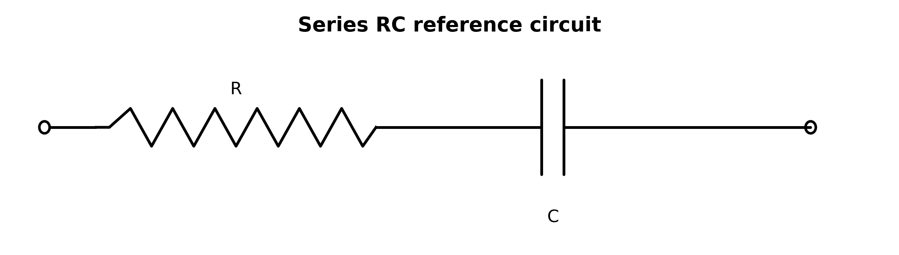
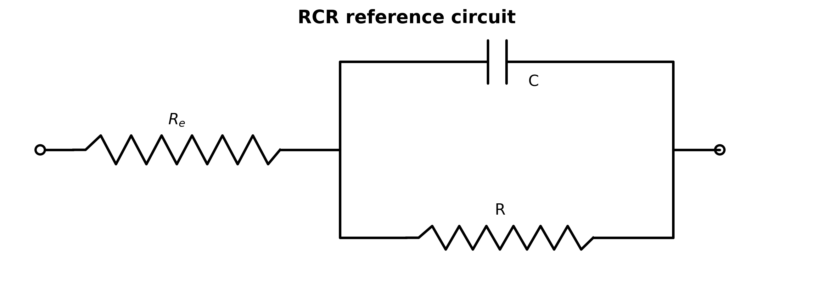
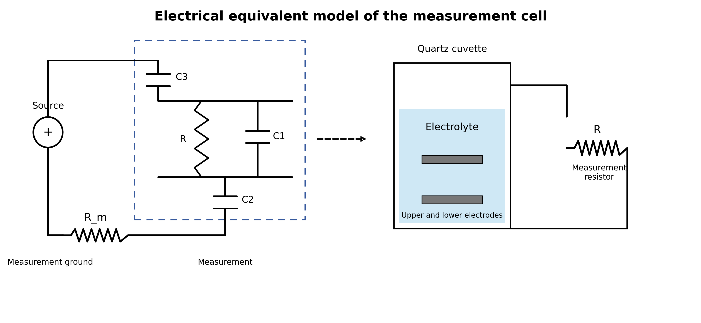

# Electrical Models and Simulation Parameters

This document records the models and component values used by the MATLAB simulation script. The values below are transcribed from the supplied thesis.

## 1. RC reference circuit



The RC reference circuit contains a 100 Ω resistor and a 20 µF capacitor. The reference amplitude is 0.1 V.

The active numerator and denominator coefficient arrays in the thesis' Listing 4.1 are:

```matlab
numerator_RC = [Vref, 0];
denominator_RC = [1, 1/(R*C)];
```

The response is evaluated at `s = jω`, where `ω = 2πf`.

## 2. RCR reference circuit



The RCR reference circuit contains a 100 Ω series resistor, a 10 Ω parallel resistor, and a 20 µF capacitor. The reference amplitude is 0.1 V.

The active coefficient arrays in the thesis' Listing 4.2 are transcribed as:

```matlab
numerator_RCR = [Vref, Vref*(R2/(C*R*R2))];
denominator_RCR = [1, (R + R2)/(R2*R*C)];
```

**Source-code note:** Listing 4.2 also defines a symbolic expression named `H1`, but the frequency-response calculation uses the coefficient arrays `a` and `b`. The consolidated simulation reproduces the active `a` and `b` arrays. This distinction is documented rather than silently replacing the thesis implementation with a different transfer function. The circuit model should be checked against the original derivation and laboratory wiring before using the RCR simulation as a new theoretical reference.

## 3. Measurement-cell equivalent circuit



The thesis models the measurement cell using a resistor and capacitor associated with the electrolyte, together with two additional series capacitances representing the cell/electrode and cable-related contributions. The circuit includes the measurement resistor in the external measurement path.

The four parameter sets used in Appendix A are:

| Configuration | R | C1 | C2 | C3 | R2 |
|---|---:|---:|---:|---:|---:|
| 1 | 100 kΩ | 1 nF | 10 nF | 1 nF | 1 kΩ |
| 2 | 100 kΩ | 8.2 nF | 10 nF | 8.2 nF | 178 Ω |
| 3 | 100 kΩ | 100 nF | 10 nF | 100 nF | 178 Ω |
| 4 | 100 kΩ | 100 nF | 10 nF | 100 nF | 1 kΩ |

The coefficient arrays implemented in the MATLAB script follow Appendix A:

```matlab
b = [1, ...
    (1/(C2*R2) + (C2*C1 + C2*C3 + C1*C3)/(C2*R*C1*C3)), ...
    (1/(R*C2*R2))*(1/C3 + 1/C1)];

a = [0, ...
    Vref*(C2*C1 + C3*C2 + C1*C3)/(R*C2*C1*C3), ...
    Vref*(1/(R*C2*R2*C3) + 1/(R*C2*R2*C1))];
```

## 4. Frequency axis and units

All simulation models in this repository use a frequency vector in Hz:

```matlab
frequency_Hz = logspace(log10(10), log10(100e3), 200).';
omega_rad_s = 2*pi*frequency_Hz;
s = 1i*omega_rad_s;
```

This explicitly spans 10 Hz to 100 kHz. The original RC listing defines a logarithmic vector and later divides it by `2*pi` for the horizontal axis; the consolidated script instead defines the intended frequency in Hz first and converts it to angular frequency. This avoids labeling an angular-frequency vector as though it were a frequency vector in Hz.

## 5. Simulation outputs

The consolidated script produces:

- RC amplitude and phase response.
- RCR amplitude and phase response.
- Combined amplitude and phase responses for the four measurement-cell configurations.
- CSV files containing the simulated numerical responses.
- MATLAB FIG and 300 dpi PNG figures.

No experimental overlays are generated unless the corresponding experimental data are added separately. The original thesis refers to experimental matrices `A`, `B`, `C`, and `D`; those measurement files were not included with the supplied uploads.

## 6. Complex-impedance calculation

The processing script follows the equation implemented in the separately supplied working file `impedancia.m`. With `V` as the reference amplitude, `V_r` as the measured magnitude, `φ` as the measured phase, `R` as the measurement resistor, `R_s` as the series resistor, and `C_p` as the parasitic capacitance:

```matlab
omega = 2*pi*frequency_Hz;
Z_m = 1/(1i*omega*C_p);
F_R = cosd(phase_deg) + 1i*sind(phase_deg);

Z = ((V./(V_r.*F_R)) - ((R_s/R) - (R_s./Z_m)) - 1) ...
    ./ ((1./Z_m) + (1/R));
C = 1./(omega.*imag(Z));
```

The script retains the sign convention of the supplied calculation. The plotting script displays `-C`, as the original working file does. The `R_s` discrepancy between the working script (50 Ω) and the thesis listing (147 Ω) must be resolved using the actual experimental component record.
