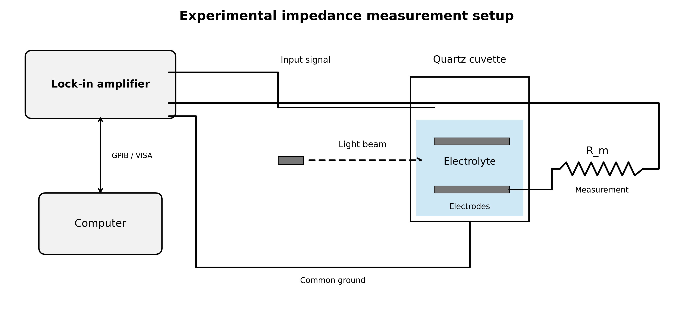

# Experimental Method

## Measurement objective

The experimental setup measures the electrical response of a liquid sample using two metallic electrodes immersed in the solution inside a quartz cuvette. A Lock-in amplifier applies a sinusoidal reference signal and measures the response magnitude and phase over a frequency sweep.

## Instrument and connection

The setup described in the thesis includes:

- A Lock-in amplifier.
- A computer connected to the Lock-in amplifier.
- A measurement resistor.
- A quartz cuvette containing the sample solution.
- Two measurement electrodes immersed in the solution.
- An optical beam path for measurements performed under illumination.

The acquisition program communicates with the instrument through NI-VISA and GPIB. The supplied source code uses the resource string `GPIB0::8::0::INSTR`.

*English schematic based on Figure 3.4 of the supplied thesis (printed page 36). The verbatim source crop is retained in `figures/source/experimental_setup_source.png`.*

## Acquisition procedure

1. Record the sample composition and the electrode configuration for the measurement.
2. Assemble the measurement setup, including the Lock-in amplifier, computer, measurement resistor, quartz cuvette, and electrodes.
3. Connect the Lock-in measurement leads to the measurement resistor and connect the signal leads to the selected electrode, maintaining the common-ground arrangement described in the thesis.
4. Establish communication between MATLAB and the Lock-in amplifier.
5. Set the reference amplitude to 0.1 V.
6. Sweep the frequency from 10 Hz to 100 kHz using 200 logarithmically spaced points.
7. At each frequency, read the response magnitude and phase using the `SNAP? 3,4` query and save the three-column dataset.

## Acquisition settings implemented in this repository

| Setting | Value |
|---|---:|
| Start frequency | 10 Hz |
| Stop frequency | 100,000 Hz (100 kHz) |
| Number of points | 200 |
| Frequency spacing | Logarithmic |
| Reference amplitude | 0.1 V |
| VISA resource | `GPIB0::8::0::INSTR` |
| Lock-in query | `SNAP? 3,4` |

The magnitude and phase returned by `SNAP? 3,4` are stored as `Amplitude_V` and `Phase_deg`. Confirm that the command returns those quantities on the specific Lock-in model used in the laboratory.

## Experimental setup figure

The thesis' Figure 3.4 is the source for the setup diagram. Figure 3.6 documents the resistance connection and the quartz cuvette with electrodes and solution. The original figure crops are retained in `figures/source/` where included.
